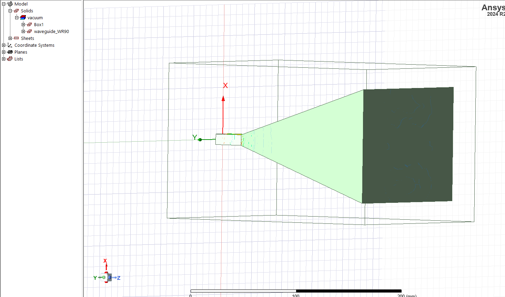
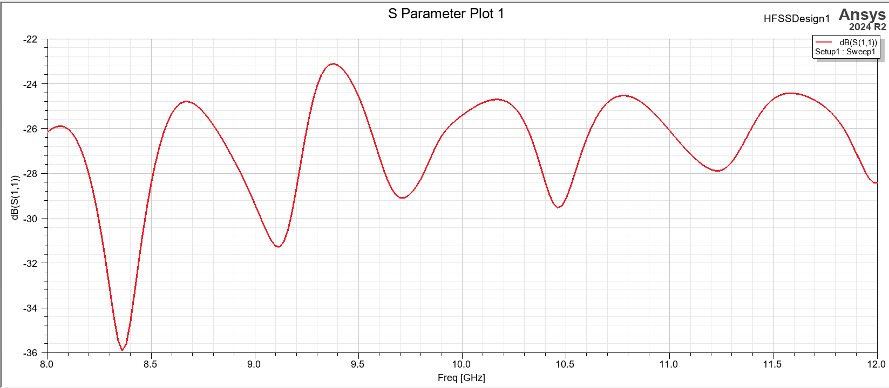
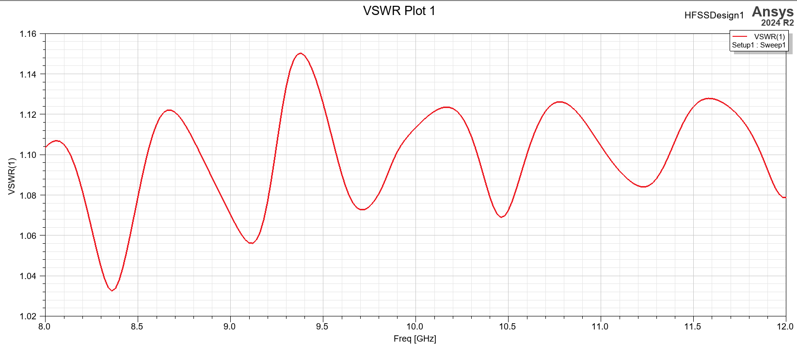
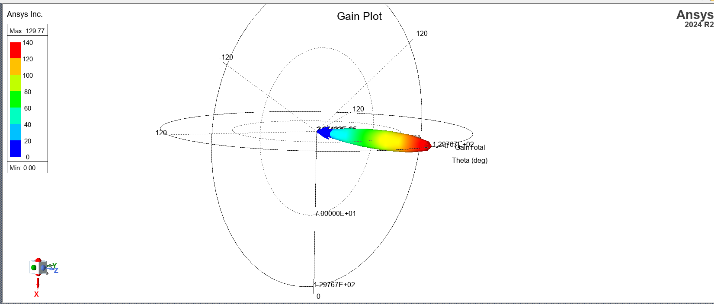
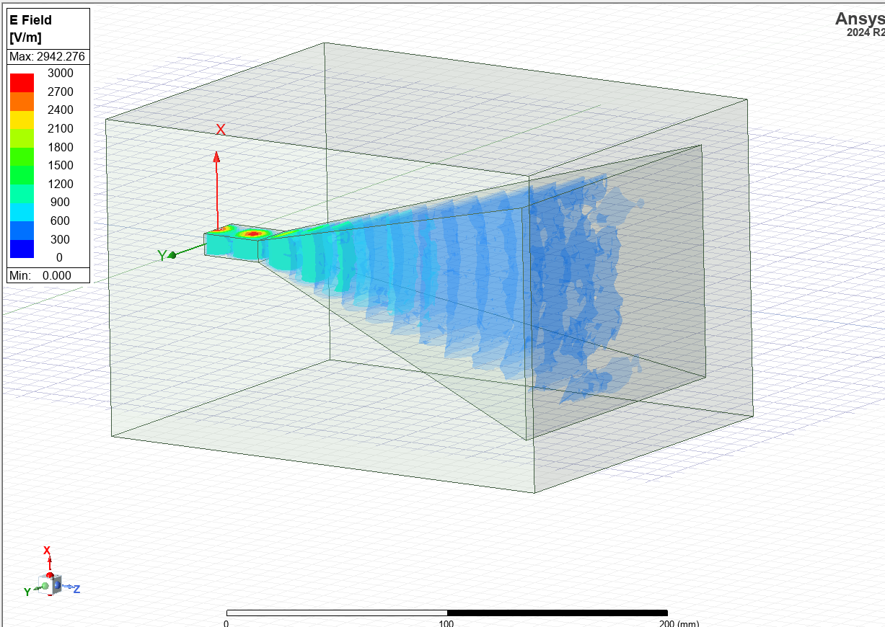
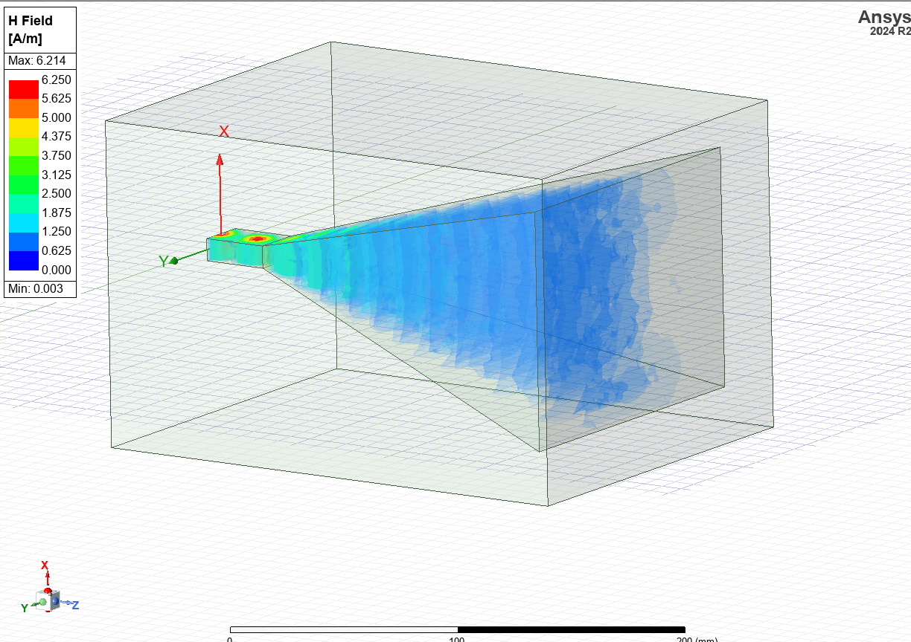

# X-Band Pyramidal Horn Antenna (Ansys HFSS)

> **Course:** Antennas, Amirkabir University of Technology. Simulated in Ansys HFSS 2024 R2; the project is in `hfss/horn.aedt`.

A pyramidal horn fed by a standard **WR-90** waveguide, designed for **10 GHz** and simulated across the X-band (8–12 GHz). The simulated gain is compared with the classical optimum-horn design equations in `design_check.py`.



## Design
| Part | Dimensions |
|---|---|
| Feed | WR-90 waveguide, 22.86 × 10.16 mm, 30 mm long (TE10 cutoff 6.56 GHz) |
| Flare | 190 mm long |
| Aperture | 148 mm (H-plane) × 110 mm (E-plane) = 4.9 λ × 3.7 λ at 10 GHz |

**Close to the optimum-gain horn.** For the slant lengths of this geometry, the optimum-gain conditions A = √(3λρ_h) and B = √(2λρ_e) give an aperture of 145.9 × 113.9 mm, within 3 % of the built 148 × 110 mm. The maximum aperture phase errors are 0.386 λ (H-plane) and 0.233 λ (E-plane), close to the optimum values of 3/8 and 1/4.

## Simulation setup
- **Model.** The horn interior (waveguide united with the flare) is vacuum. Its eight side walls are Perfect-E boundaries, so the metal walls have zero thickness.
- **Port.** A modal wave port at the back of the waveguide, carrying the TE10 mode.
- **Open space.** The horn sits in a vacuum box with a radiation boundary at least λ/4 from the structure.
- **Solver.** Adaptive meshing at 10 GHz (ΔS ≤ 0.02, up to 15 passes), then a frequency sweep from 8 to 12 GHz.

## Results
| Quantity | Result |
|---|---|
| Return loss, 8–12 GHz | **S11 between −23 and −36 dB** across the whole band |
| VSWR, 8–12 GHz | **< 1.15** |
| Peak gain at 10 GHz | **129.8 = 21.1 dBi** |
| Aperture efficiency | 0.57 |
| Optimum-horn theory, 0.51 × 4πAB/λ² | 20.7 dBi, which the simulation is within 0.5 dB of |

| Return loss | VSWR |
|---|---|
|  |  |

**Matching.** The ripple in S11 comes from small reflections at the waveguide–flare junction and at the aperture. They interfere with a period set by the 190 mm flare length. The gradual flare transforms the waveguide impedance to free space, so the match stays very good over the whole band.



**Radiation.** The 3-D pattern shows a single pencil beam along the horn axis (+z), with low side and back lobes.

| \|E\| inside the horn | \|H\| inside the horn |
|---|---|
|  |  |

**Fields.** The TE10 mode leaves the waveguide and spreads through the flare as almost-spherical phase fronts, which reach the aperture with only a small phase error.

## Files
| File | Content |
|---|---|
| `hfss/horn.aedt` | HFSS project: geometry, boundaries, setup and plots. Open it and choose Analyze All to reproduce the results; solution data is not tracked. |
| `design_check.py` | Classical pyramidal-horn equations (Balanis): optimum dimensions, phase error, expected gain |
| `figures/` | Exported HFSS plots |

```bash
python design_check.py
```

**Sepehr Ebrahimi**, B.Sc. Electrical Engineering, Amirkabir University of Technology (2026)
